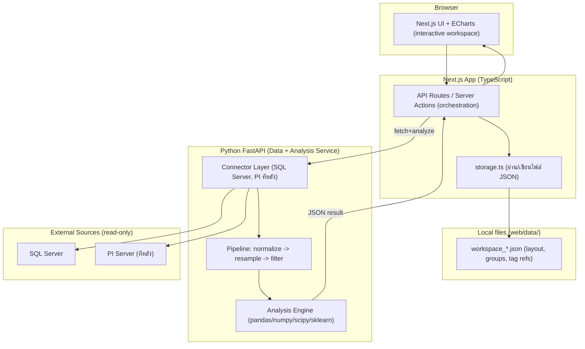

# Architecture

## 1. High-Level



**Key decisions**

- Connector Layer อยู่ฝั่ง **FastAPI** → `fetch → normalize → resample → filter → analyze` ที่เดียว
- Next.js = UI + orchestration + เก็บ metadata เป็นไฟล์ JSON
- **ไม่มี database ของเราเอง** — V1 ไม่เก็บ time-series ซ้ำ, ดึงตรงจาก source

---

## 2. Data Flow (V1)

```text
User
 -> Next.js UI (เลือก tag, ช่วงเวลา, resample, analysis, filter config)
 -> Next.js API (validate + โหลด tag metadata)
 -> FastAPI /data หรือ /analyze  (ส่ง tag refs + params)
     -> Connector -> SQL / PI (read-only, parameterized)
     -> Normalize -> format กลาง
     -> Resample
     -> Filter / Clean
     -> Analysis (ถ้าเป็น /analyze)
 -> Return JSON
 -> UI Render Chart / Table / Export
```

---

## 3. Metadata (ไฟล์ JSON — ไม่มี DB)

metadata เก็บเป็นไฟล์ JSON ต่อ **project** ที่ `web/data/projects/<id>.json` (gitignored)
โครงสร้างตาม `Project` ใน `web/lib/types.ts`, อ่าน/เขียนผ่าน `web/lib/projects.ts`:

```jsonc
// web/data/projects/golden-batch.json
{
  "id": "golden-batch",
  "name": "Golden Batch",
  "createdAt": "...", "updatedAt": "...",
  "tags": [ { "tag": "PULP-LINE2-KAPPA-PRESS1", "description": "", "group": "LAB" } ],
  "groups": ["LAB", "param"],
  "classDefs": [ { "id": "press1-digester", "type": "one-hot", ... } ],  // ดู app/pipeline/classify.py
  "settings": { "interval": "15m", "activeTags": [...], "panels": [...], "chartClass": {...} }
}
```

> API: `GET/POST /api/projects` (list / create / restore จากถัง) · `GET/PATCH/DELETE /api/projects/<id>`
> ลบ = ย้ายไป `web/data/projects/_trash/` แล้วลบถาวรเมื่อเกิน 7 วัน

---

## 4. Standard Data Format (Connector output)

Single point:

```json
{
  "tagId": "tag-001",
  "tagName": "furnace_01_temperature",
  "timestamp": "2026-09-17T08:00:00Z",
  "value": 82.5,
  "quality": "GOOD",
  "unit": "C"
}
```

Columnar (แนะนำสำหรับ payload ใหญ่ / chart):

```json
{
  "tagId": "tag-001",
  "tagName": "furnace_01_temperature",
  "unit": "C",
  "timestamps": ["2026-09-17T08:00:00Z", "2026-09-17T08:01:00Z"],
  "values": [82.5, 82.7],
  "qualities": ["GOOD", "GOOD"]
}
```

---

## 5. API Contract (Next.js <-> FastAPI)

### POST /data — ดึง time-series สำหรับ chart

```jsonc
// Request
{
  "tags": [
    { "tagId": "tag-001", "source": { "type": "SQL", "connectionRef": "sql-prod-1", "sourceTagName": "FURN01_TEMP" } }
  ],
  "timeRange": { "start": "2026-09-01T00:00:00Z", "end": "2026-09-17T00:00:00Z" },
  "resample": { "interval": "5m", "method": "mean" },
  "filters": [
    { "type": "quality", "keep": ["GOOD"] },
    { "type": "range", "min": 0, "max": 1500 }
  ]
}

// Response (columnar)
{
  "status": "ok",
  "series": [
    { "tagId": "tag-001", "unit": "C", "timestamps": [...], "values": [...] }
  ],
  "meta": { "rowsBefore": 24000, "rowsAfterFilter": 23110 }
}
```

### POST /analyze — วิเคราะห์

```jsonc
{
  "tags": [ /* เหมือน /data */ ],
  "timeRange": { ... },
  "resample": { ... },
  "filters": [ ... ],
  "analysis": { "type": "correlation" }  // summary|sd|boxplot|kde|correlation|clustering
}
```

---

## 6. Filter / Cleaning (config-driven)

| Filter   | Config                | ใช้เมื่อ                                |
| -------- | --------------------- | ----------------------------------------------- |
| quality  | `keep: ["GOOD"]`    | ตัด bad quality                              |
| range    | `min, max`          | ตัดค่าเพี้ยน / เครื่องปิด |
| flatline | `window, tolerance` | ค่าค้างนิ่งผิดปกติ            |
| zscore   | `threshold`         | outlier                                         |
| iqr      | `factor`            | outlier แบบ robust                           |

---

## 7. Security (ต้อง design ตั้งแต่ต้น)

| หัวข้อ  | แนวทาง                                                                         |
| ------------- | ------------------------------------------------------------------------------------ |
| Credentials   | เก็บใน `web/.env` (gitignored), ไม่ commit; ไม่เขียน plaintext ลง JSON |
| SQL injection | parameterized query เสมอ; user เลือก tag/time เท่านั้น              |
| Read-only     | ใช้ account สิทธิ์ read/SELECT อย่างเดียว                         |
| Timezone      | เก็บ/ส่ง UTC (ISO 8601), แปลง local ที่ UI                             |

---

## 8. Open Decisions (ต้องตัดสินใจ)

1. **PI access** — PI Web API (REST) vs OLEDB/SQL → ออกแบบ PI adapter เป็น interface เดียว, เลือก backend ทีหลัง
2. **Charting lib** — ECharts (แนะนำ, dataZoom ดี) vs Plotly
3. **หลายคน/หลายเครื่อง** — ถ้าอนาคตต้องแชร์ ค่อยเพิ่ม DB (ตอนนี้ไฟล์ JSON พอ)
