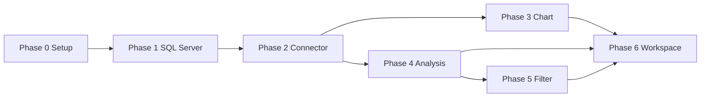

# Roadmap — แผนลงมือทำเป็น Step

> ทำตามลำดับ Phase 0 → 6 แต่ละ Phase มี **Goal**, **Steps**, **Definition of Done (DoD)**
> checklist ละเอียดอยู่ที่ [tasks-checklist.md](tasks-checklist.md)

---

## Phase 0 — Project Setup

**Goal:** โครง monorepo รันได้ (web + analysis-service)

**Steps**
1. สร้าง monorepo: `web/` (Next.js TS) + `analysis-service/` (FastAPI) + `docs/`
2. Next.js: init + TailwindCSS + ESLint/Prettier
3. FastAPI: skeleton + `/health` endpoint
4. เชื่อม web → FastAPI ได้ (call `/health` จาก Next.js API)

**DoD:** เปิดหน้าเว็บได้ + hit `/health` ผ่าน

---

## Phase 1 — เชื่อม SQL Server + เลือก Tag

**Goal:** เชื่อม SQL Server ต้นทาง (read-only) + เลือก table/column ที่จะดู

**Steps**
1. FastAPI connector: `base.py` + `sql_server.py` (pymssql, read-only)
2. API: `/connections/test`, `/databases`, `/tables`, `/columns`
3. UI: หน้ากรอก connection (host/user/pass/db) + ปุ่ม test
4. UI: browse databases → tables → columns → เลือก time column + value column
5. เก็บ tag/group ที่เลือกเป็นไฟล์ JSON (`web/data/`)

**DoD:** กรอก connection → test ผ่าน → เลือก tag → save เป็นไฟล์ได้

---

## Phase 2 — Connector + Data Fetch

**Goal:** ดึง time-series จริงจาก SQL/PI → format กลาง

**Steps**
1. FastAPI connector base interface (`BaseConnector.fetch(...)`)
2. `sql_adapter.py` — parameterized query, read-only
3. `pi_adapter.py` — interface พร้อม (backend เลือกทีหลัง: PI Web API / OLEDB)
4. Normalize → columnar standard format
5. Resample (interval + method: mean/last/interpolated)
6. `POST /data` endpoint
7. Next.js: proxy `/api/data` → FastAPI `/data`

**DoD:** ขอข้อมูล 1 tag ช่วงเวลาหนึ่ง แล้วได้ columnar JSON กลับมา

---

## Phase 3 — Interactive Chart Workspace (Must-have UX)

**Goal:** chart interactive multi-series (ยืม pattern จาก TradingView — zoom/pan/crosshair)

**Steps**
1. ติดตั้ง ECharts + wrapper (`ChartCanvas.tsx`)
2. Render line chart จาก `/data`
3. dataZoom (scroll zoom + slider) + pan
4. Crosshair + tooltip หลาย series
5. Multi-series overlay + legend toggle
6. `TimeRangeSelector` (preset + custom)
7. `TagSearch` + `TagTreeSidebar` เพิ่ม tag เข้า chart
8. `ChartWorkspace` state management

**DoD:** ค้น tag → เพิ่มเข้า chart → zoom/pan/crosshair ได้ครบ

> ความหลากหลาย (chart types, layout modes) เพิ่มใน Phase 4+ ตาม [tradingview-ux.md](tradingview-ux.md#6-ความหลากหลาย-จุดที่เหนือกว่า-tradingview)

---

## Phase 4 — Analysis Engine

**Goal:** วิเคราะห์ทั้ง 6 แบบ

**Steps**
1. `analysis/` modules: summary, sd, boxplot, kde, correlation, clustering
2. `POST /analyze` endpoint (รับ analysis.type)
3. Next.js proxy `/api/analyze`
4. `AnalysisPanel.tsx` tabs
5. Visualization mapping:
   - summary → table
   - SD → line/band ใน sub-pane
   - boxplot → ECharts boxplot
   - KDE → density curve
   - correlation → heatmap
   - clustering → scatter สีตาม cluster

**DoD:** เลือก tag + analysis type → เห็นผลเป็น chart/table

---

## Phase 5 — Filter / Cleaning

**Goal:** pipeline ทำความสะอาดข้อมูล config-driven

**Steps**
1. `pipeline/filter.py`: quality, range, flatline, zscore, iqr
2. รับ `filters[]` ใน `/data` และ `/analyze`
3. คืน meta: `rowsBefore`, `rowsAfterFilter`
4. UI: filter config panel (เปิด/ปิดแต่ละ filter + params)

**DoD:** ตั้ง filter แล้วข้อมูล/ผลวิเคราะห์เปลี่ยนตาม + เห็นจำนวน row ที่ถูกตัด

---

## Phase 6 — Workspace & Templates

**Goal:** save/reuse layout + template + audit

**Steps**
1. Save `WorkspaceState` → ไฟล์ JSON (`web/data/workspace_*.json`)
2. Load workspace กลับมา render เหมือนเดิม
3. Analysis template (save config วิเคราะห์เป็นไฟล์)
4. Export result (CSV / PNG)

**DoD:** save workspace → refresh/เปิดใหม่ → กลับมาได้เหมือนเดิม + export ได้

---

## สรุป Dependency

